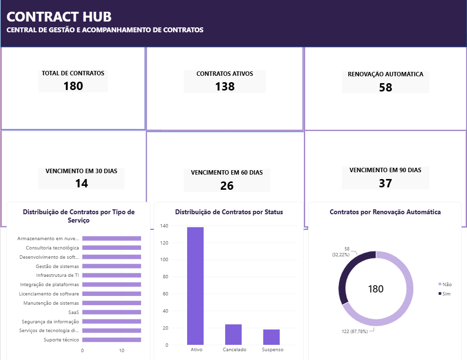
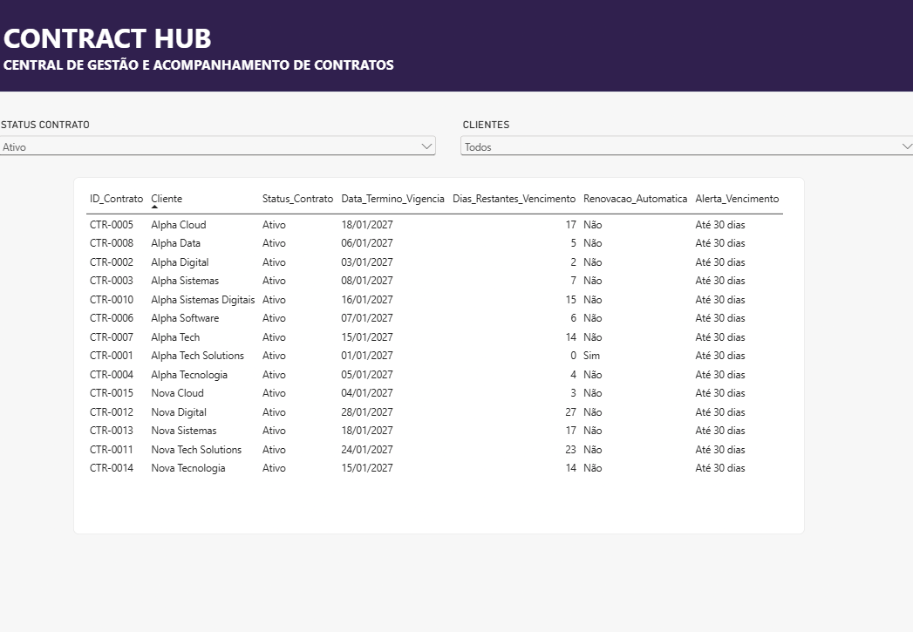

# CONTRACT HUB
### Central de Gestão e Acompanhamento de Contratos

## Sobre o projeto

O CONTRACT HUB é um projeto de análise de dados aplicado à gestão contratual, desenvolvido para demonstrar como a integração entre Direito, tecnologia e análise de dados pode contribuir para a eficiência operacional jurídica.

O projeto surgiu da necessidade de centralizar informações contratuais e facilitar o acompanhamento de prazos, vencimentos, renovações automáticas e status dos contratos.

A solução foi desenvolvida como um protótipo funcional, utilizando uma base de 180 contratos fictícios.

## Objetivo

Estruturar, tratar, consultar e visualizar dados contratuais, transformando informações operacionais em indicadores que auxiliem no acompanhamento da carteira de contratos e na tomada de decisões.

## Tecnologias utilizadas

- **Google Sheets:** estruturação da base de dados.
- **Python e Pandas:** tratamento, limpeza e padronização dos dados.
- **SQL e SQLite:** armazenamento e consultas.
- **Power BI:** construção de dashboards e indicadores interativos.
- **VS Code:** desenvolvimento e organização dos arquivos.

## Etapas do desenvolvimento

1. Estruturação de uma base fictícia com 180 contratos.
2. Tratamento e validação dos dados utilizando Python e Pandas.
3. Criação de banco de dados SQLite e execução de consultas SQL.
4. Preparação dos dados para visualização no Power BI.
5. Desenvolvimento de dashboards com indicadores, gráficos e filtros.
6. Testes de consistência e interação dos elementos visuais.

## Principais indicadores

| Indicador | Quantidade |
|---|---:|
| Total de contratos | 180 |
| Contratos ativos | 138 |
| Contratos cancelados | 24 |
| Contratos suspensos | 18 |
| Renovação automática | 58 |
| Contratos ativos com vencimento em até 30 dias | 14 |
| Contratos ativos com vencimento em até 60 dias | 26 |
| Contratos ativos com vencimento em até 90 dias | 37 |

**Nota:** os indicadores de vencimento consideram a data de referência de 01/01/2027. Os períodos são acumulativos.

## Dashboards desenvolvidos

**Dashboard Final:** visão geral da carteira contratual, com indicadores de desempenho, distribuição por status, tipos de serviço e renovação automática.

**Acompanhamento Contratual:** visualização detalhada dos contratos, com filtros por cliente e status e acompanhamento de vencimentos.

### Visualização dos Dashboards

**Dashboard Final**

**Acompanhamento Contratual**

## Atualização dos dados

O projeto utiliza uma base estruturada e um processo de tratamento com Python. Para incluir novos contratos, é necessário atualizar a base de origem, executar novamente o tratamento, atualizar o CSV utilizado pelo Power BI e atualizar os dados no relatório.

A atualização é atualmente manual. A automação desse processo e a implementação de indicadores dinâmicos de vencimento são possibilidades de evolução.

## Resultados

O projeto demonstra a aplicação prática de ferramentas de análise de dados à gestão contratual, permitindo centralizar informações, identificar contratos próximos do vencimento e visualizar indicadores relevantes para o acompanhamento operacional.

## Observações

Este projeto foi desenvolvido para fins educacionais e de portfólio profissional. Todos os dados contratuais utilizados são fictícios.